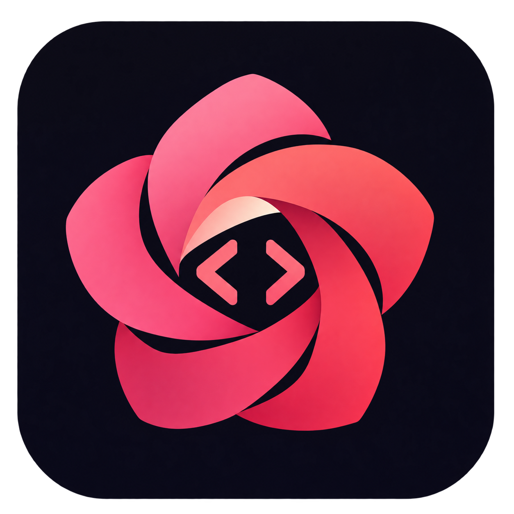

<p align="center">
  
</p>

# RoseCode

AI 编程 Agent 的统一工作空间：供应商与模型管理、本地网关、内置 Claude 工作区、会话与用量统计、界面增强。

**RoseCode 基于 [CodexPlusPlus](https://github.com/BigPizzaV3/CodexPlusPlus) 二次开发。原作者为 [BigPizzaV3](https://github.com/BigPizzaV3) 及 CodexPlusPlus 贡献者；RoseCode 分支由 [Alan1145145](https://github.com/Alan1145145) 维护。感谢原作者与所有上游贡献者。**

本项目保留上游版权和许可证，继续以 **AGPL-3.0-only** 开源。详见 [LICENSE](LICENSE)、[署名与修改说明](NOTICE.md) 和 [第三方声明](THIRD_PARTY_NOTICES.md)。

[项目源码](https://github.com/Alan1145145/RoseCode) · [下载与版本](https://github.com/Alan1145145/RoseCode/releases) · [反馈问题](https://github.com/Alan1145145/RoseCode/issues) · [English](README_EN.md)

## 主要功能

- 管理 AI 编程 Agent 的供应商、API Key、默认模型和上下文窗口。
- 内置本地网关，支持多供应商、模型路由和故障切换。
- 在 RoseCode 内配置 Claude 上游和 Desktop 增强，无需额外打开 ClaudeMom 窗口。
- 统一查看会话、请求日志、Token、缓存与费用统计。
- 保留上游的拓展、MCP、Skills、Codex 增强和原生配置兼容能力。
- 界面主题首次默认跟随系统，也可手动选择浅色或深色。

## 下载与使用

安装包与更新说明统一发布到 [RoseCode Releases](https://github.com/Alan1145145/RoseCode/releases)。如果尚无已发布版本，可按下文从源码构建。

应用内的项目地址、GitHub 问题反馈和更新检查均指向 `Alan1145145/RoseCode`。更新源为本仓库 Release 附件中的 `latest.json`，不从上游仓库安装更新。

首次打开后，在供应商池配置自己的连接和 Key，再选择需要接入的 Agent。账号凭据、本地状态与构建产物不随本仓库发布。

## 反馈与交流

- 问题与建议：[GitHub Issues](https://github.com/Alan1145145/RoseCode/issues)。请附系统、RoseCode 版本、复现步骤和已脱敏日志。
- **QQ 群聊：473502913**。应用「关于 → 反馈与社区」可复制群号，在 QQ 中按群号搜索加入。

## 从源码构建

需要 Node.js / npm、Rust 稳定版，以及对应平台的 Tauri 原生构建环境。Windows 需要 Visual Studio C++ 构建工具和 Windows SDK。

```bash
git clone https://github.com/Alan1145145/RoseCode.git
cd RoseCode/apps/codex-plus-manager
npm ci
npm run check
npm test
npm run vite:build
cd ../..
cargo build --release -p codex-plus-manager --bin rosecode
```

主程序位于 `target/release/rosecode.exe`（Windows）或 `target/release/rosecode`（其他平台）。日常使用的 Claude 功能已内置于主程序。

核心测试示例：

```bash
cargo test -p codex-plus-core --test all updater::
cargo test -p codex-plus-manager --lib
```

### Google 订阅登录的本地配置

源码和安装包不内置 Google OAuth 客户端凭据。使用 Gemini Code Assist 或 Antigravity 的订阅登录、刷新令牌前，需要在启动 RoseCode 的进程环境中设置相应 OAuth 应用的配置：

| 登录类型 | Client ID 环境变量 | Client Secret 环境变量 |
| --- | --- | --- |
| Gemini Code Assist | `ROSECODE_GEMINI_OAUTH_CLIENT_ID` | `ROSECODE_GEMINI_OAUTH_CLIENT_SECRET` |
| Antigravity | `ROSECODE_ANTIGRAVITY_OAUTH_CLIENT_ID` | `ROSECODE_ANTIGRAVITY_OAUTH_CLIENT_SECRET` |

缺少配置时应用会明确提示；导入的 Google 登录令牌必须属于所配置的客户端。普通 API 供应商和其他 Agent 不需要这些变量。不要将实际凭据提交到仓库。

修改 renderer 注入分片后，应运行 `node scripts/assemble-renderer-inject.mjs` 重新组装。

## 版本发布

先在 `CHANGELOG.md` 顶部写好 `## X.Y.Z - YYYY-MM-DD` 更新说明，再运行：

```bash
node scripts/release.mjs X.Y.Z --dry-run
node scripts/release.mjs X.Y.Z
```

脚本会统一版本号、提交、打 `vX.Y.Z` 标签并推送到 `origin`。本仓库的 `Release assets` 工作流使用 `github.repository` 构建附件并生成 `latest.json`，附件齐备后发布。安装包文件名统一使用 `RoseCode-*`，发布地址和更新来源属于 RoseCode。

默认发布 Windows 安装版与便携版，Linux DEB 构建成功时一并提供。macOS 需维护者配置本仓库自己的 Apple Developer ID 签名与公证凭据，并将仓库变量 `RELEASE_MACOS_ENABLED` 设为 `true` 后才启用；不会借用上游证书或发布未签名的 macOS 包。

已有附件的草稿可以通过 `Release assets` 手动选择 `platform=publish-existing`、`publish=true` 重新校验附件、生成校验和与更新元数据后公开，无需重复编译。

首次创建源码仓库不会自动打版本标签或生成安装包。发布状态与各平台支持以本仓库 Releases 和 Actions 的实际结果为准。

## 项目结构

- `apps/codex-plus-manager/`：Tauri 桌面应用与 React / TypeScript 前端。
- `crates/codex-plus-core/`：配置、网关、更新和运行时核心。
- `crates/codex-plus-data/`：会话和数据持久化。
- `assets/`：注入脚本、内置拓展与资源。
- `scripts/`：组装、打包和发版脚本。

## 版权与上游致谢

- 原项目：[CodexPlusPlus](https://github.com/BigPizzaV3/CodexPlusPlus)。
- 原作者：[BigPizzaV3](https://github.com/BigPizzaV3) 及 CodexPlusPlus 贡献者。
- 原项目版权：Copyright (C) 2026 BigPizzaV3。
- RoseCode 修改与维护：Copyright (C) 2026 Alan1145145 and RoseCode contributors。
- 许可证：[GNU Affero General Public License v3.0](LICENSE)，SPDX：`AGPL-3.0-only`。

分发和提供修改版本时，请按许可证提供相应源代码并保留版权、许可证和第三方声明。第三方代码、字体、图标及素材仍遵循各自许可证，见 [THIRD_PARTY_NOTICES.md](THIRD_PARTY_NOTICES.md) 和资源目录中的声明。
